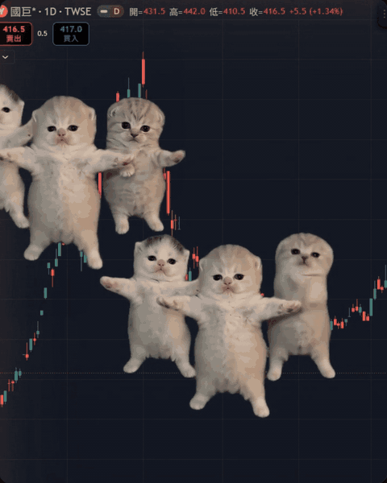
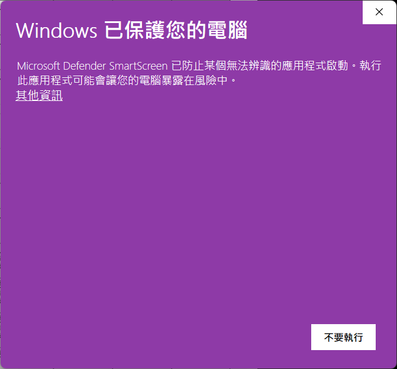
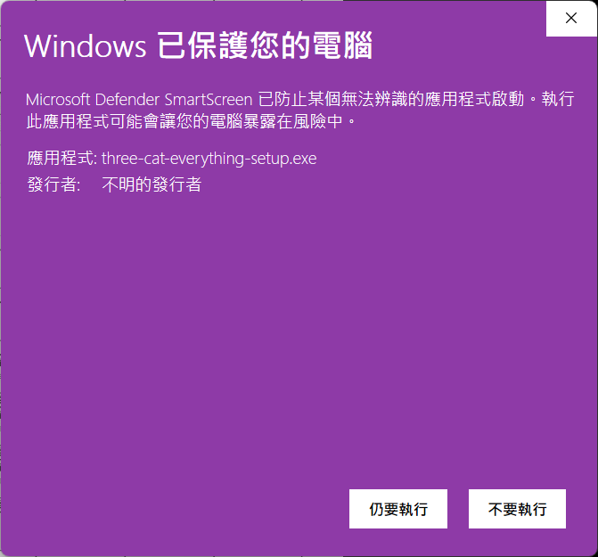
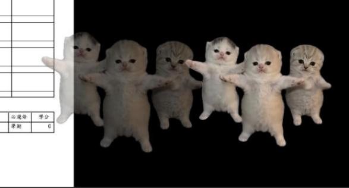

# three-cat-everything

漲停小貓，在你的螢幕上一直跳。📈🐱🐱🐱

把爆紅的「三隻跳舞小貓」放到 Windows 桌面的任何角落：透明背景、永遠置頂、無限循環。邊看盤邊讓牠們陪你等漲停。

<p align="center"></p>

<p align="center">
  <a href="https://github.com/baabaa-works/three-cat-everything/releases/latest/download/three-cat-everything-setup.exe"></a><br>
  <sub>免費・約 4MB・Windows 10 / 11（64 位元）</sub>
</p>

<p align="center">📱 用手機看到？用電腦開這頁，或先按右上角 ⭐ 收藏</p>

## 安裝三步驟

1. 點上面的綠色按鈕下載安裝檔。
2. 雙擊安裝檔。若出現「Windows 已保護您的電腦」，點「其他資訊」→「仍要執行」。會跳這個警告是因為小貓沒有付費的程式碼簽章，不是中毒。

    
3. 裝好後，小貓會出現在螢幕右下角。

> 看到「智慧型應用程式控制已封鎖」的話，目前裝不了，歡迎到 [issue](https://github.com/baabaa-works/three-cat-everything/issues) 留言告訴我。

### 裝好之後

- 小貓在螢幕右下角，左鍵拖曳可以移到任何地方。
- 右鍵叫出選單：再來一組、滑鼠穿透等等。
- 預設靜音，點一下小貓播音樂。

找不到按鈕或想看舊版：到 [Releases](https://github.com/baabaa-works/three-cat-everything/releases) 下載 `three-cat-everything-setup.exe`。

## 怎麼玩

| 操作 | 效果 |
|---|---|
| 左鍵拖曳 | 移動小貓 |
| 左鍵單擊 | 播放 / 停止音樂（預設靜音） |
| 滾輪 | 放大縮小 |
| 右鍵 | 選單：大小、透明度、鎖定位置、滑鼠穿透、再來一組、移除 |
| 系統匣圖示 | 再來一組、全部顯示 / 隱藏、解除全部滑鼠穿透、開機自動啟動、結束 |

- 最多可以同時放 5 組；同一時間只會有一組播音樂。
- **滑鼠穿透**：開啟後小貓不再擋住下面的視窗（例如看盤軟體），但也點不到牠們了；要從系統匣選「解除全部滑鼠穿透」來恢復。
- 位置、大小、透明度、鎖定狀態都會記住，重開後還原。



## 開發

需求：Node 22+、Rust stable、Visual Studio C++ Build Tools、WebView2。

```bash
npm install
npx tauri dev
```

打包：

```bash
npx tauri build
```

### 重做素材

`src/assets/cats.webm` 是從綠幕影片去背而來（VP9 + alpha，含 Opus 音軌）。要重新產生：

```bash
python -m venv .venv
.venv/Scripts/pip install yt-dlp imageio-ffmpeg numpy pillow
.venv/Scripts/yt-dlp -o raw/source.mp4 "https://www.tiktok.com/@igreenscreenthings/video/7659169323495214367"
npm run asset
```

## Credits

- Original animation by [@meowtakeover](https://www.tiktok.com/@meowtakeover)
- Green-screen version by [@igreenscreenthings](https://www.tiktok.com/@igreenscreenthings)

本專案與上述創作者無關。若您是原作者並希望移除素材，請開 issue 聯繫。

---

**English:** A tiny Windows desktop overlay that keeps the viral three dancing kittens looping on top of everything — transparent, always-on-top, click to play the music, scroll to resize. Built with Tauri.
